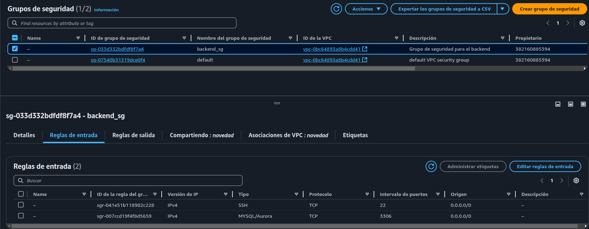

# Practica-IAW-4.3- Ejercicios con AWS-python-boto3

## Ejercicio 1. Crear un grupo de seguridad con el nombre backend-sg con las reglas Acceso SSH (puerto 22/TCP) desde cualquier dirección IP y Acceso al puerto 3306/TCP desde cualquier dirección IP al grupo de seguridad:

```bash
from common import aws_resource_functions as aws

# Hacer las reglas de entrada del grupo de seguridad
ingress_permissions = [
    {'CidrIp': '0.0.0.0/0', 'IpProtocol': 'tcp', 'FromPort': 22, 'ToPort': 22},
    {'CidrIp': '0.0.0.0/0', 'IpProtocol': 'tcp', 'FromPort': 3306, 'ToPort': 3306}
]

# Definir el nombre y la descripción del grupo de seguridad
sg_name = 'backend-sg'
sg_description = 'Grupo de seguridad para el backend'

# Crear el grupo de seguridad
aws.create_security_group(sg_name, sg_description, ingress_permissions)

# Listar los grupos de seguridad
aws.list_security_groups()
```




## Ejercicio 2. Escriba un script de Python para crear una instancia EC2 que tengas las siguientes características: Identificador de la AMI: ami-08e637cea2f053dfa, esta AMI se corresponde con la imagen Red Hat Enterprise Linux 9 (HVM), número de instancias: 1, tipo de instancia: t2.micro, clave privada: vockey, grupo de seguridad: backend-sg, nombre de la instancia: backend.

```bash
from common import aws_resource_functions as aws

# ID del AMI
ami = 'ami-08e637cea2f053dfa'

# Tipo de instancia
instance_type = 't2.micro'

# Clave privada
key_name = 'vockey'

# Nombre de la instancia y grupo de seguridad
instance_name = 'backend'
sg_name = 'backend-sg'

# Comprobar que el grupo de seguridad existe
if aws.security_group_exists(sg_name) == False:
    print('The security group does not exist')
    exit()

# Crear la instancia
aws.create_instance(ami, 1, instance_type, key_name, instance_name, sg_name)

# Listar las instancias
aws.list_instances()
```


## Ejercicio 3.1. Crear un script para crear la infraestructura de la práctica 1.11.

```bash
#!/bin/bash
set -x

# Deshabilitamos la paginación de la salida de los comandos de AWS CLI
export AWS_PAGER=""

# Variables de configuración
source .env

# Crear IPs elásticas y guardar en el archivo .env
for i in {1..2}; do
  ELASTIC_IP_FRONTEND[i]=$(aws ec2 allocate-address --query 'PublicIp' --output text)
  echo "ELASTIC_IP_FRONTEND_$i=${ELASTIC_IP_FRONTEND[i]}" >> .env
done
ELASTIC_IP_BACKEND=$(aws ec2 allocate-address --query 'PublicIp' --output text)
echo "ELASTIC_IP_BACKEND=$ELASTIC_IP_BACKEND" >> .env
ELASTIC_IP_BALANCEADOR=$(aws ec2 allocate-address --query 'PublicIp' --output text)
echo "ELASTIC_IP_BALANCEADOR=$ELASTIC_IP_BALANCEADOR" >> .env
ELASTIC_IP_NFS=$(aws ec2 allocate-address --query 'PublicIp' --output text)
echo "ELASTIC_IP_NFS=$ELASTIC_IP_NFS" >> .env

# Creamos el grupo de seguridad: frontend-sg
aws ec2 create-security-group --group-name $SECURITY_GROUP_FRONTEND --description "Reglas para el frontend"
aws ec2 authorize-security-group-ingress --group-name $SECURITY_GROUP_FRONTEND --protocol tcp --port 22 --cidr 0.0.0.0/0
aws ec2 authorize-security-group-ingress --group-name $SECURITY_GROUP_FRONTEND --protocol tcp --port 2049 --cidr 0.0.0.0/0
aws ec2 authorize-security-group-ingress --group-name $SECURITY_GROUP_FRONTEND --protocol tcp --port 80 --cidr 0.0.0.0/0
aws ec2 authorize-security-group-ingress --group-name $SECURITY_GROUP_FRONTEND --protocol tcp --port 443 --cidr 0.0.0.0/0
aws ec2 authorize-security-group-ingress --group-name $SECURITY_GROUP_FRONTEND --protocol tcp --port 3306 --cidr 0.0.0.0/0

# Creamos el grupo de seguridad: backend-sg
aws ec2 create-security-group --group-name $SECURITY_GROUP_BACKEND --description "Reglas para el backend"
aws ec2 authorize-security-group-ingress --group-name $SECURITY_GROUP_BACKEND --protocol tcp --port 22 --cidr 0.0.0.0/0
aws ec2 authorize-security-group-ingress --group-name $SECURITY_GROUP_BACKEND --protocol tcp --port 3306 --cidr 0.0.0.0/0

# Creamos el grupo de seguridad: balanceador-sg
aws ec2 create-security-group --group-name $SECURITY_GROUP_BALANCEADOR --description "Reglas para el balanceador de carga"
aws ec2 authorize-security-group-ingress --group-name $SECURITY_GROUP_BALANCEADOR --protocol tcp --port 22 --cidr 0.0.0.0/0
aws ec2 authorize-security-group-ingress --group-name $SECURITY_GROUP_BALANCEADOR --protocol tcp --port 3306 --cidr 0.0.0.0/0
aws ec2 authorize-security-group-ingress --group-name $SECURITY_GROUP_BALANCEADOR --protocol tcp --port 80 --cidr 0.0.0.0/0
aws ec2 authorize-security-group-ingress --group-name $SECURITY_GROUP_BALANCEADOR --protocol tcp --port 443 --cidr 0.0.0.0/0
aws ec2 authorize-security-group-ingress --group-name $SECURITY_GROUP_BALANCEADOR --protocol tcp --port 2049 --cidr 0.0.0.0/0

# Creamos el grupo de seguridad: nfs-sg
aws ec2 create-security-group --group-name $SECURITY_GROUP_NFS --description "Reglas para el servidor NFS"
aws ec2 authorize-security-group-ingress --group-name $SECURITY_GROUP_NFS --protocol tcp --port 22 --cidr 0.0.0.0/0
aws ec2 authorize-security-group-ingress --group-name $SECURITY_GROUP_NFS --protocol tcp --port 2049 --cidr 0.0.0.0/0

# Crear instancias EC2 para el frontend y esperar a que estén en estado running
for i in {1..2}; do
  INSTANCE_ID=$(aws ec2 run-instances \
    --image-id $AMI_ID \
    --count 1 \
    --instance-type $INSTANCE_TYPE \
    --key-name $KEY_NAME \
    --security-groups $SECURITY_GROUP_FRONTEND \
    --tag-specifications "ResourceType=instance,Tags=[{Key=Name,Value=frontend-$i}]" \
    --query 'Instances[0].InstanceId' --output text)

  aws ec2 wait instance-running --instance-ids $INSTANCE_ID

  aws ec2 associate-address --instance-id $INSTANCE_ID --public-ip ${ELASTIC_IP_FRONTEND[i]}
done

# Crear una instancia EC2 para el backend y esperar a que esté en estado running
INSTANCE_ID_BACKEND=$(aws ec2 run-instances \
    --image-id $AMI_ID \
    --count 1 \
    --instance-type $INSTANCE_TYPE \
    --key-name $KEY_NAME \
    --security-groups $SECURITY_GROUP_BACKEND \
    --tag-specifications "ResourceType=instance,Tags=[{Key=Name,Value=$INSTANCE_NAME_BACKEND}]" \
    --query 'Instances[0].InstanceId' --output text)

aws ec2 wait instance-running --instance-ids $INSTANCE_ID_BACKEND

aws ec2 associate-address --instance-id $INSTANCE_ID_BACKEND --public-ip $ELASTIC_IP_BACKEND

# Crear una instancia EC2 para el balanceador de carga y esperar a que esté en estado running
INSTANCE_ID_BALANCEADOR=$(aws ec2 run-instances \
    --image-id $AMI_ID \
    --count 1 \
    --instance-type $INSTANCE_TYPE \
    --key-name $KEY_NAME \
    --security-groups $SECURITY_GROUP_BALANCEADOR \
    --tag-specifications "ResourceType=instance,Tags=[{Key=Name,Value=$INSTANCE_NAME_BALANCEADOR}]" \
    --query 'Instances[0].InstanceId' --output text)

aws ec2 wait instance-running --instance-ids $INSTANCE_ID_BALANCEADOR

aws ec2 associate-address --instance-id $INSTANCE_ID_BALANCEADOR --public-ip $ELASTIC_IP_BALANCEADOR

# Crear una instancia EC2 para el NFS y esperar a que esté en estado running
INSTANCE_ID_NFS=$(aws ec2 run-instances \
    --image-id $AMI_ID \
    --count 1 \
    --instance-type $INSTANCE_TYPE \
    --key-name $KEY_NAME \
    --security-groups $SECURITY_GROUP_NFS \
    --tag-specifications "ResourceType=instance,Tags=[{Key=Name,Value=$INSTANCE_NAME_NFS}]" \
    --query 'Instances[0].InstanceId' --output text)

aws ec2 wait instance-running --instance-ids $INSTANCE_ID_NFS

aws ec2 associate-address --instance-id $INSTANCE_ID_NFS --public-ip $ELASTIC_IP_NFS
```


## Ejercicio 3.2. Crear un script para la eliminación de la infraestructura de la práctica 1.11.

```bash
#!/bin/bash
set -x

# Deshabilitamos la paginación de la salida de los comandos de AWS CLI
export AWS_PAGER=""

# Variables de configuración
source .env

# Eliminar instancias frontend, liberar IPs elásticas y esperar a que estén terminadas
for i in 1 2; do
  INSTANCE_ID=$(aws ec2 describe-instances \
                --filters "Name=tag:Name,Values=$INSTANCE_NAME_FRONTEND-$i" \
                          "Name=instance-state-name,Values=running" \
                --query "Reservations[*].Instances[*].InstanceId" \
                --output text)

  ELASTIC_IP_VAR="ELASTIC_IP_FRONTEND_$i"
  ELASTIC_IP=${!ELASTIC_IP_VAR}

  aws ec2 disassociate-address --public-ip $ELASTIC_IP
  aws ec2 release-address --public-ip $ELASTIC_IP
  aws ec2 terminate-instances --instance-ids $INSTANCE_ID
  aws ec2 wait instance-terminated --instance-ids $INSTANCE_ID
done

# Eliminar instancia backend, liberar IP elástica y esperar a que esté terminada
INSTANCE_ID_BACKEND=$(aws ec2 describe-instances \
                      --filters "Name=tag:Name,Values=$INSTANCE_NAME_BACKEND" \
                                "Name=instance-state-name,Values=running" \
                      --query "Reservations[*].Instances[*].InstanceId" \
                      --output text)

ELASTIC_IP_BACKEND=$ELASTIC_IP_BACKEND

aws ec2 disassociate-address --public-ip $ELASTIC_IP_BACKEND
aws ec2 release-address --public-ip $ELASTIC_IP_BACKEND
aws ec2 terminate-instances --instance-ids $INSTANCE_ID_BACKEND
aws ec2 wait instance-terminated --instance-ids $INSTANCE_ID_BACKEND

# Eliminar instancia balanceador, liberar IP elástica y esperar a que esté terminada
INSTANCE_ID_BALANCEADOR=$(aws ec2 describe-instances \
                          --filters "Name=tag:Name,Values=$INSTANCE_NAME_BALANCEADOR" \
                                    "Name=instance-state-name,Values=running" \
                          --query "Reservations[*].Instances[*].InstanceId" \
                          --output text)

ELASTIC_IP_BALANCEADOR=$ELASTIC_IP_BALANCEADOR

aws ec2 disassociate-address --public-ip $ELASTIC_IP_BALANCEADOR
aws ec2 release-address --public-ip $ELASTIC_IP_BALANCEADOR
aws ec2 terminate-instances --instance-ids $INSTANCE_ID_BALANCEADOR
aws ec2 wait instance-terminated --instance-ids $INSTANCE_ID_BALANCEADOR

# Eliminar instancia NFS, liberar IP elástica y esperar a que esté terminada
INSTANCE_ID_NFS=$(aws ec2 describe-instances \
                  --filters "Name=tag:Name,Values=$INSTANCE_NAME_NFS" \
                            "Name=instance-state-name,Values=running" \
                  --query "Reservations[*].Instances[*].InstanceId" \
                  --output text)

ELASTIC_IP_NFS=$ELASTIC_IP_NFS

aws ec2 disassociate-address --public-ip $ELASTIC_IP_NFS
aws ec2 release-address --public-ip $ELASTIC_IP_NFS
aws ec2 terminate-instances --instance-ids $INSTANCE_ID_NFS
aws ec2 wait instance-terminated --instance-ids $INSTANCE_ID_NFS

# Eliminar grupos de seguridad
aws ec2 delete-security-group --group-name $SECURITY_GROUP_FRONTEND
aws ec2 delete-security-group --group-name $SECURITY_GROUP_BACKEND
aws ec2 delete-security-group --group-name $SECURITY_GROUP_BALANCEADOR
aws ec2 delete-security-group --group-name $SECURITY_GROUP_NFS
```


