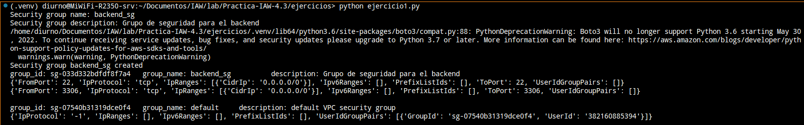
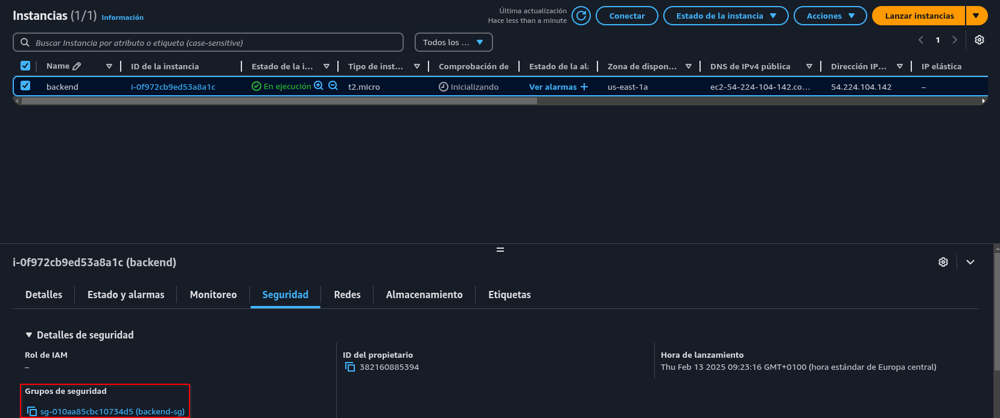
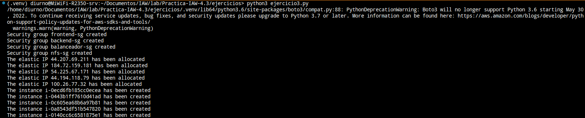
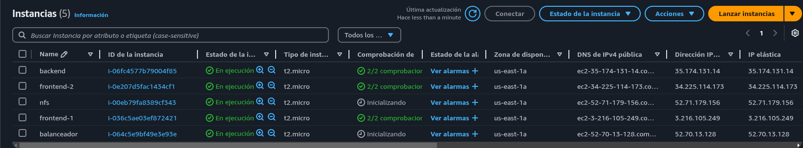
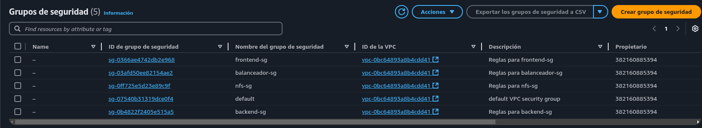
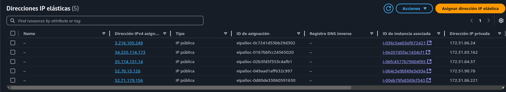
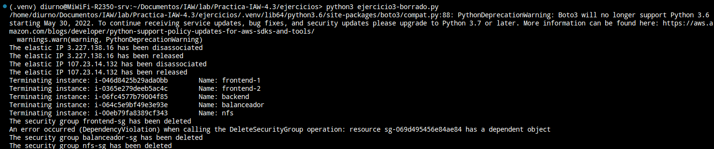
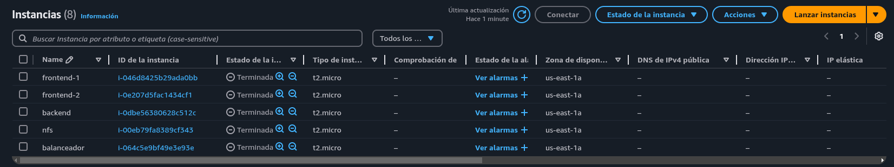
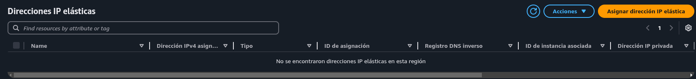

# Practica-IAW-4.3- Ejercicios con AWS-python-boto3

## Ejercicio 1. Crear un grupo de seguridad con el nombre backend-sg con las reglas Acceso SSH (puerto 22/TCP) desde cualquier dirección IP y Acceso al puerto 3306/TCP desde cualquier dirección IP al grupo de seguridad:

```bash
from common import aws_resource_functions as aws

# Hacer las reglas de entrada del grupo de seguridad
ingress_permissions = [
    {'CidrIp': '0.0.0.0/0', 'IpProtocol': 'tcp', 'FromPort': 22, 'ToPort': 22},
    {'CidrIp': '0.0.0.0/0', 'IpProtocol': 'tcp', 'FromPort': 3306, 'ToPort': 3306}
]

# Definir el nombre y la descripción del grupo de seguridad
sg_name = 'backend-sg'
sg_description = 'Grupo de seguridad para el backend'

# Crear el grupo de seguridad
aws.create_security_group(sg_name, sg_description, ingress_permissions)

# Listar los grupos de seguridad
aws.list_security_groups()
```




## Ejercicio 2. Escriba un script de Python para crear una instancia EC2 que tengas las siguientes características: Identificador de la AMI: ami-08e637cea2f053dfa, esta AMI se corresponde con la imagen Red Hat Enterprise Linux 9 (HVM), número de instancias: 1, tipo de instancia: t2.micro, clave privada: vockey, grupo de seguridad: backend-sg, nombre de la instancia: backend.

```bash
from common import aws_resource_functions as aws

# ID del AMI
ami = 'ami-08e637cea2f053dfa'

# Tipo de instancia
instance_type = 't2.micro'

# Clave privada
key_name = 'vockey'

# Nombre de la instancia y grupo de seguridad
instance_name = 'backend'
sg_name = 'backend-sg'

# Comprobar que el grupo de seguridad existe
if aws.security_group_exists(sg_name) == False:
    print('The security group does not exist')
    exit()

# Crear la instancia
aws.create_instance(ami, 1, instance_type, key_name, instance_name, sg_name)

# Listar las instancias
aws.list_instances()
```




## Ejercicio 3.1. Crear un script para crear la infraestructura de la práctica 1.11.

```bash
from common import aws_resource_functions as aws
import boto3
import time

# ID del AMI
ami = 'ami-04b4f1a9cf54c11d0'

# Tipo de instancia
instance_type = 't2.micro'

# Clave privada
key_name = 'vockey'

# Nombres de las instancias y grupos de seguridad
nombres_instancias = ['frontend-1', 'frontend-2', 'backend', 'balanceador', 'nfs']
nombres_sg = ['frontend-sg', 'frontend-sg', 'backend-sg', 'balanceador-sg', 'nfs-sg']

# Reglas para los grupos de seguridad
reglas_sg = {
    'frontend-sg': [
        {'IpProtocol': 'tcp', 'FromPort': 22, 'ToPort': 22, 'CidrIp': '0.0.0.0/0'},
        {'IpProtocol': 'tcp', 'FromPort': 2049, 'ToPort': 2049, 'CidrIp': '0.0.0.0/0'},
        {'IpProtocol': 'tcp', 'FromPort': 80, 'ToPort': 80, 'CidrIp': '0.0.0.0/0'},
        {'IpProtocol': 'tcp', 'FromPort': 443, 'ToPort': 443, 'CidrIp': '0.0.0.0/0'},
        {'IpProtocol': 'tcp', 'FromPort': 3306, 'ToPort': 3306, 'CidrIp': '0.0.0.0/0'}
    ],
    'backend-sg': [
        {'IpProtocol': 'tcp', 'FromPort': 22, 'ToPort': 22, 'CidrIp': '0.0.0.0/0'},
        {'IpProtocol': 'tcp', 'FromPort': 3306, 'ToPort': 3306, 'CidrIp': '0.0.0.0/0'}
    ],
    'balanceador-sg': [
        {'IpProtocol': 'tcp', 'FromPort': 22, 'ToPort': 22, 'CidrIp': '0.0.0.0/0'},
        {'IpProtocol': 'tcp', 'FromPort': 3306, 'ToPort': 3306, 'CidrIp': '0.0.0.0/0'},
        {'IpProtocol': 'tcp', 'FromPort': 80, 'ToPort': 80, 'CidrIp': '0.0.0.0/0'},
        {'IpProtocol': 'tcp', 'FromPort': 443, 'ToPort': 443, 'CidrIp': '0.0.0.0/0'},
        {'IpProtocol': 'tcp', 'FromPort': 2049, 'ToPort': 2049, 'CidrIp': '0.0.0.0/0'}
    ],
    'nfs-sg': [
        {'IpProtocol': 'tcp', 'FromPort': 22, 'ToPort': 22, 'CidrIp': '0.0.0.0/0'},
        {'IpProtocol': 'tcp', 'FromPort': 2049, 'ToPort': 2049, 'CidrIp': '0.0.0.0/0'}
    ]
}

# Crear grupos de seguridad si no existen
for nombre_sg, reglas in reglas_sg.items():
    if not aws.security_group_exists(nombre_sg):
        aws.create_security_group(nombre_sg, f'Reglas para {nombre_sg}', reglas)

# Crear IPs elásticas
ips_elasticas = {}
for nombre_instancia in nombres_instancias:
    ip_elastica = aws.allocate_elastic_ip()
    ips_elasticas[nombre_instancia] = ip_elastica

# Crear las instancias y asociar IPs elásticas
for nombre_instancia, nombre_sg in zip(nombres_instancias, nombres_sg):
    aws.create_instance(ami, 1, instance_type, key_name, nombre_instancia, nombre_sg)
    id_instancia = aws.get_instance_id(nombre_instancia)
    
    # Verificar el estado de la instancia y esperar hasta que esté en estado "running"
    ec2 = boto3.resource('ec2')
    instance = ec2.Instance(id_instancia)
    instance.wait_until_running()
    
    # Asociar la IP elástica a la instancia
    aws.associate_elastic_ip(ips_elasticas[nombre_instancia], id_instancia)
```





## Ejercicio 3.2. Crear un script para la eliminación de la infraestructura de la práctica 1.11.

```bash
from common import aws_resource_functions as aws

# Nombres de las instancias y grupos de seguridad
nombres_instancias = ['frontend-1', 'frontend-2', 'backend', 'balanceador', 'nfs']
nombres_sg = ['frontend-sg', 'frontend-sg', 'backend-sg', 'balanceador-sg', 'nfs-sg']

# Eliminar IPs elásticas y desvincularlas de las instancias
for nombre_instancia in nombres_instancias:
    id_instancia = aws.get_instance_id(nombre_instancia)
    if id_instancia:
        public_ip = aws.get_instance_public_ip(id_instancia)
        if public_ip:
            aws.disassociate_elastic_ip(public_ip)
            aws.release_elastic_ip(public_ip)

# Terminar instancias
for nombre_instancia in nombres_instancias:
    id_instancia = aws.get_instance_id(nombre_instancia)
    if id_instancia:
        aws.terminate_instance_by_id(id_instancia)
        
# Eliminar grupos de seguridad
for nombre_sg in nombres_sg:
    if aws.security_group_exists(nombre_sg):
        aws.delete_security_group(nombre_sg)
```



> [!IMPORTANT]  
> El script de eliminación funciona correctamente, lo que pasa esque al borrar muchas máquinas y volver a crearlas y demás, da un error en la eliminación de algo 
> porque aws se queda pillado algunas veces y pasa eso, pero si lo ejecuto 1 vez y luego lo ejecuto de nuevo, ya no da error.



